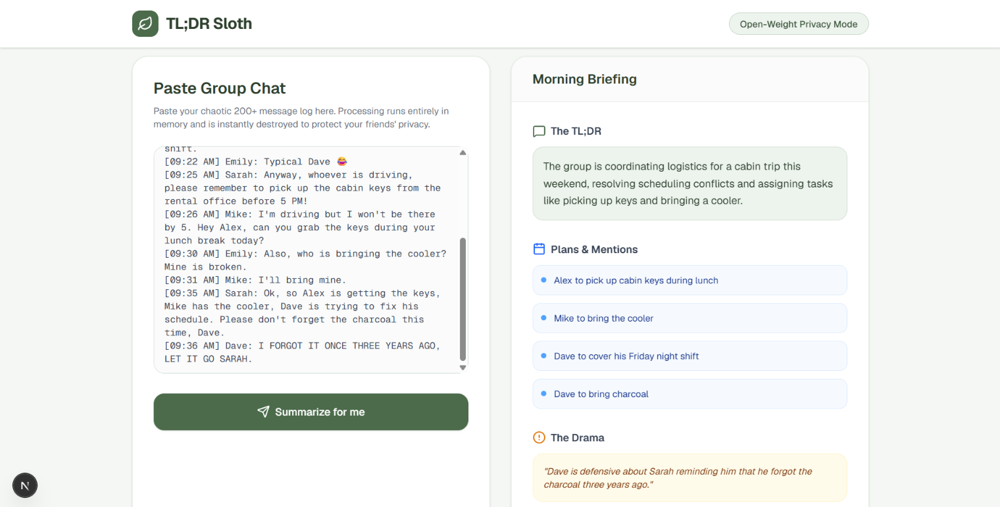

# 🦥 TL;DR Sloth

> **Your lazy, privacy-first group chat summarizer. Let the sloth do the reading.**

---

## 📸 Demo & Live Application

**Take it for a spin:** [https://tldr-sloth.vercel.app](https://tldr-sloth.vercel.app)

_(Note: Ensure your screenshot is saved as `demo.png` inside your `frontend/public/` folder so this image loads perfectly on GitHub!)_

---

## 💤 The Problem: Group Chats are Exhausting

You step away from your phone for two hours, and suddenly your group chat has 150 missed messages. People are arguing, plans are being made, and someone is asking you a direct question—but finding it means scrolling through endless memes and chaotic texting.

You _could_ paste the chat into a generic AI like ChatGPT, but group chats contain your friends' personal lives, inside jokes, and private drama. Commercial AI tools store that data and use it to train their corporate models.

**Nobody wants their private group chat drama harvested by big tech.**

---

## 🌿 The Solution: Embrace Your Inner Sloth

**TL;DR Sloth** was built to reward laziness while fiercely protecting your privacy.

Instead of reading the chaos yourself, you just paste the chat log into the app. In seconds, our highly efficient, open-source "Sloth" will read the conversation and hand you a clean, 3-part morning briefing:

1. **The TL;DR:** A single sentence summarizing what the conversation was actually about.
2. **Plans & Mentions:** A bulleted list of any actual plans made, or if anyone specifically asked you to do something.
3. **The Drama:** A quick summary of any arguments, tension, or funny moments so you're not out of the loop.

### 🔒 100% Private & Stateless

TL;DR Sloth is built on a strict **"in-and-out" memory design**.

- We do not have a database.
- We do not require an account or a login.
- The application is powered by transparent, **open-weight AI models**.

When you click "Summarize," your chat log exists in the server's temporary memory for exactly 4 seconds. The second your summary appears on the screen, your group chat is instantly and permanently destroyed.

---

## 🚀 How to Use It

1. Open your chaotic group chat (WhatsApp, Discord, iMessage, Slack).
2. Copy the wall of missed messages.
3. Open [TL;DR Sloth](https://tldr-sloth.vercel.app).
4. Paste the chat and click **"Summarize for me"**.
5. Relax. Let the sloth do the work.

---

## 🏆 Built for Hacktoberfest 2026

This project was proudly created for the **Hacktoberfest "Slow and Steady" Challenge**, proving that open-source artificial intelligence can be used to build everyday automation tools that respect user privacy and cost nothing to run.

---

## 📜 License

This project is open-source and available under the [MIT License](LICENSE).
